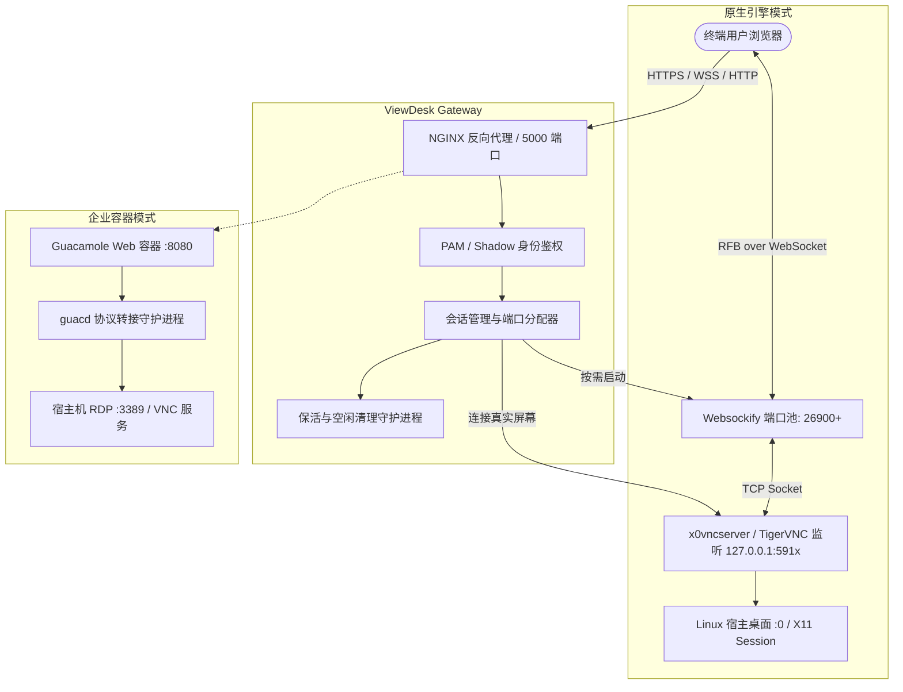

# ViewDesk: Web-based Remote Desktop Gateway
# 产品需求文档 (Product Requirements Document, PRD)

---

## 1. 文档概述

- **项目名称**：ViewDesk (轻量级 Web 端 Linux 远程桌面网关系统)
- **文档版本**：v1.0.0
- **创建日期**：2026-11-09
- **状态**：正式发布 (Approved)
- **目标读者**：开发者、运维工程师、系统架构师、开源社区贡献者

---

## 2. 产品背景与定位

### 2.1 行业痛点
1. **客户端依赖繁琐**：传统的远程桌面连接方式（如 Remmina、VNC Viewer、Microsoft Remote Desktop 等）需要客户端预先安装特定软件，在跨平台（如 iPad、移动端、公共终端）场景下极不方便。
2. **安全风险较高**：直接将 VNC（5900+）或 RDP（3389）端口暴露在公网面临严重的暴力破解和网络探测风险。
3. **运维与资源消耗大**：多用户共享服务器时，常驻虚拟桌面会持续占用大量 GPU/CPU 算力与内存，缺乏自动化按需分配与超时释放机制。
4. **多方案场景割裂**：用户往往需要在“轻量免安装原生桌面抓取”与“企业级标准容器化协议网关”之间权衡，缺乏统一的参考实现。

### 2.2 产品定位
**ViewDesk** 是一款面向开发者、算法工程师和系统管理员的 **轻量、免客户端、开箱即用的 Web 远程桌面网关系统**。
用户只需任意现代 Web 浏览器，即可安全、高速地访问 Linux 宿主机的真实图形桌面（`:0`）或多用户独立虚拟桌面，无需安装任何客户端软件。

项目提供 **双轨制架构支持**：
1. **原生轻量架构**：基于 Flask + PAM 认证 + TigerVNC (`x0vncserver`) + websockify + noVNC，提供秒级按需拉起、动态分配、低资源开销的极简体验。
2. **企业级容器架构**：基于 Apache Guacamole + guacd (Docker Compose)，提供工业级 RDP/VNC 协议转接、屏幕自适应 (`display-update`) 与企业级访问控制。

---

## 3. 用户画像与核心应用场景

| 角色 | 典型特征 | 核心诉求 |
| :--- | :--- | :--- |
| **AI / 算法研究员** | 在高性能 Linux 服务器上跑实验，本地使用 Mac/Windows/iPad | 随时打开浏览器查看模型训练可视化界面、TensorBoard、GUI 调试器 |
| **系统运维工程师** | 管理多台物理机/虚拟机 | 无需在跳板机配置客户端，通过浏览器直接登录并接管真实屏幕 |
| **教学与高校实验室** | 师生共享服务器环境 | 一人一号，动态按需拉起桌面，下课或超时自动销毁会话释放资源 |
| **远程办公个人用户** | 异地访问家里或办公室主机 | 浏览器输入 URL 即可访问桌面，支持断网重连与保活 |

---

## 4. 产品架构与工作原理

### 4.1 总体架构图



### 4.2 双方案技术对比

| 维度 | 原生引擎 (Flask + noVNC) | 企业级容器 (Apache Guacamole) |
| :--- | :--- | :--- |
| **部署形态** | Python 原生进程 + Systemd / Shell 守护 | Docker + Docker Compose 容器化 |
| **底层协议** | RFB over WebSocket (HTML5 noVNC) | Guacamole Protocol over HTTP/WebSocket |
| **屏幕模式** | 直接镜像真实屏幕 (`DISPLAY=:0`) 或按需虚拟桌面 | 支持 RDP 远程桌面 / VNC 多协议 |
| **认证方式** | Linux 本地系统账号 (PAM / /etc/shadow) | 用户映射文件 (XML) / 数据库 (MySQL/LDAP) |
| **资源占用** | 极轻量（~30MB 内存开销） | 中等（Java 容器 + guacd C 守护进程） |
| **分辨率适配** | 前端 Canvas 动态缩放 / 保持宽高比 | 原生支持 `display-update` 动态重采样 |
| **特色功能** | 进程级健康探测、精准 PID 保活、定时超时清理 | 字体平滑、剪贴板管理、多会话并发管理 |

---

## 5. 功能需求 (Functional Requirements)

### 5.1 身份认证与权限管理 (FR-01)
- **FR-01.1 本地系统账号鉴权**：支持直接使用 Linux 宿主机账号与密码登录（通过 `python-pam` 模块调用系统 PAM 服务）。
- **FR-01.2 降级认证机制**：当 PAM 环境受限时，自动降级至读取 `/etc/shadow` 进行哈希安全比对。
- **FR-01.3 输入安全过滤**：严格校验用户名格式，防止命令注入与越权探测。
- **FR-01.4 密码脱敏与隔离**：后端内部随机生成 8 字节临时 VNC 访问口令，避免明文暴露在网络与配置文件中。

### 5.2 真实屏幕与虚拟桌面管理 (FR-02)
- **FR-02.1 真实桌面镜像 (Real Display)**：自动定位宿主机当前活动显示器（`DISPLAY=:0`）及对应 Xauthority 凭据（如 GDM/LightDM/用户目录凭据），利用 `x0vncserver` 实时抓取。
- **FR-02.2 虚拟桌面支持 (Virtual Desktop)**：内建备用 `xstartup` 机制，按优先级自动检测并拉起 XFCE4、GNOME 或 Openbox 桌面。
- **FR-02.3 端口与 Display 自动寻址**：
  - 自动寻找空闲 VNC Display（`10 ~ 99`），绑定 `127.0.0.1` 本地回环端口，杜绝公网暴露。
  - 自动在专用区间分配 Websockify 端口（`26900 ~ 26900 + MAX_USERS`）。

### 5.3 会话生命周期与自愈保活 (FR-03)
- **FR-03.1 会话动态创建**：登录成功后，按需异步拉起 VNC 进程与 Websockify 代理，返回客户端专属直连会话。
- **FR-03.2 心跳保持 (Keepalive)**：前端页面每 60 秒上报一次心跳至 `/api/keepalive`，刷新最后活跃时间。
- **FR-03.3 空闲超时回收**：后台守护线程每 5 分钟轮询，超过设定时长（默认 1 小时）未活跃的会话自动关闭 VNC 及 Websockify 进程，释放内存与 CPU。
- **FR-03.4 专属守护进程 (`keepalive_daemon.sh`)**：
  - 双重健康检查：精准探测服务 PID 与端口存活状态。
  - 绝不使用盲杀（`killall`），杜绝误伤宿主机其他系统服务。
  - 异常退出时自动拉起并记录带时间戳的审计日志。
- **FR-03.5 平滑重启 (`restart.sh`)**：一键停止旧服务进程、清理 PID 缓存并自动重新加载启动。

### 5.4 前端交互与沉浸式体验 (FR-04)
- **FR-04.1 纯 HTML5 免插件**：基于 Canvas 渲染，不依赖 Flash、Java Applet 或本地客户端。
- **FR-04.2 响应式自适应布局**：支持根据浏览器窗口尺寸自动保持画面比例缩放（`scale-viewport`），支持一键全屏。
- **FR-04.3 常用快捷键支持**：内建常用桌面控制快捷栏（如 `Ctrl+Alt+Del` 发送、剪贴板呼出、控制栏悬浮收折）。

---

## 6. 非功能需求 (Non-Functional Requirements)

### 6.1 安全性 (Security)
1. **最小权限暴露**：底层 VNC 服务仅监听 `127.0.0.1`，仅通过受控的 WebSocket 网关或 NGINX 反向代理对外暴露。
2. **凭据安全**：传输层强制推荐启用 HTTPS/WSS 加密传输；配置文件中密码提供脱敏示例，禁止敏感明文硬编码入库。
3. **会话隔离**：每个用户登录分配独立的随机 Token 与隔离的端口，避免会话串扰。

### 6.2 性能与延迟 (Performance)
1. **超低接入延迟**：本地局域网环境下端到端交互延迟 $\le 30\text{ ms}$。
2. **轻量内存占用**：网关服务内存占用 $\le 50\text{ MB}$，单个活跃桌面会话资源占用受限。
3. **并发容量**：默认支持单节点同时在线并发会话 10+（可通过 `MAX_USERS` 可配置扩容）。

### 6.3 兼容性 (Compatibility)
- **操作系统**：Ubuntu 20.04 LTS / 22.04 LTS / 24.04 LTS，Debian 11 / 12，CentOS / Rocky Linux 8+。
- **浏览器**：Google Chrome $\ge 90$、Microsoft Edge $\ge 90$、Firefox $\ge 88$、Safari $\ge 14$ 及主流移动端浏览器。

---

## 7. 目录结构规范

```text
view_desk/
├── PRD.md                             # 产品需求文档
├── README.md                          # 项目中英文使用与开发说明
├── LICENSE                            # 开源许可证 (MIT)
├── CONTRIBUTING.md                     # 开源共建与贡献指南
├── .gitignore                         # Git 忽略规则
├── .env.example                       # 环境变量脱敏示例模板
├── install_remote_desktop.sh          # 一键安装与系统服务配置脚本
│
├── remote_desktop/                    # [方案 A] 原生轻量 Web 远程桌面网关
│   ├── app.py                         # 核心 Flask 网关与会话生命周期调度
│   ├── requirements.txt               # Python 依赖项
│   ├── start.sh                       # 一键启动脚本 (自适应环境探测)
│   ├── restart.sh                     # 专属平滑重启脚本
│   ├── keepalive_daemon.sh            # 精准 PID 与端口双重保活守护脚本
│   ├── xstartup                       # 虚拟 X 桌面初始化脚本
│   └── templates/                     # 前端 UI 模版
│       ├── login.html                 # 现代化登录界面
│       └── desktop.html               # noVNC 远程桌面集成交互界面
│
└── guacamole_real_desktop/            # [方案 B] 企业级 Apache Guacamole 方案
    ├── docker-compose.yml             # 容器编排文件 (guacd + guacamole)
    └── guac_home/                     # Guacamole 挂载配置目录
        ├── guacamole.properties       # 基础属性配置
        ├── user-mapping.xml           # 访问控制与连接映射
        └── user-mapping.xml.example   # 映射模板参考
```

---

## 8. 未来规划 (Roadmap)

- **v1.1.0**：增加两步验证 (2FA / TOTP) 登录支持，增强公网暴露下的安全性。
- **v1.2.0**：增加 Web 端音频双向转发（基于 WebAudio API 与 PulseAudio 桥接）。
- **v1.3.0**：增加跨平台剪贴板双向同步增强与拖拽文件上传/下载功能。
- **v1.4.0**：提供多节点集中管控面板，支持集群化分发多台物理机桌面的统一门户。
