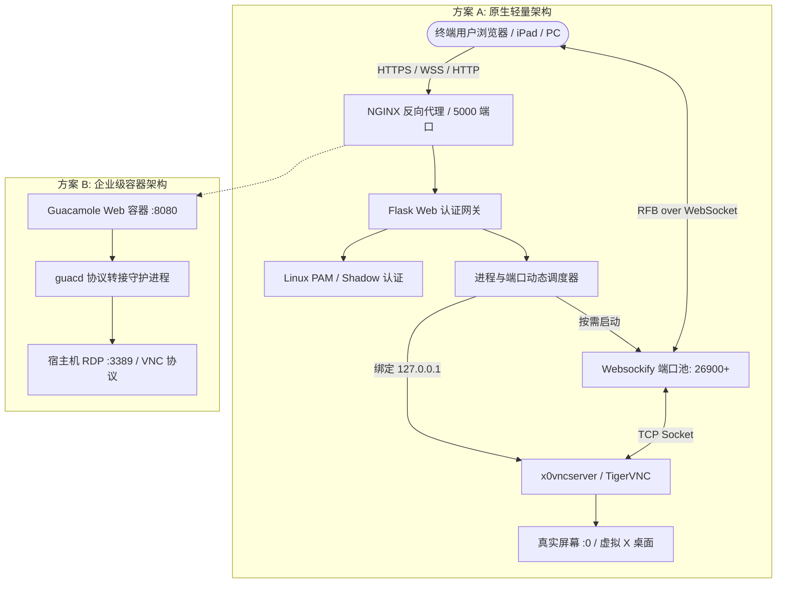

# ViewDesk: Web-based Remote Desktop Gateway

<p align="center">
  
  
  
  
</p>

> **ViewDesk** 是一款面向开发者、算法工程师和系统管理员的 **轻量、免客户端、开箱即用的 Web 远程桌面网关系统**。只需任意现代浏览器，即可安全、流畅地控制 Linux 宿主机的真实桌面（`:0`）或多用户虚拟桌面。

---

## 🌟 核心特性

- 🌐 **纯 Web 访问，零客户端依赖**：无需安装 VNC Viewer、Remmina 或任何本地客户端，打开 Chrome / Edge / Safari 即可远程操控。
- 🖥️ **真实桌面镜像**：支持直接接管宿主机的物理显示屏桌面（`DISPLAY=:0`，利用 `x0vncserver` 实时捕获）。
- 🔐 **系统原生 PAM 鉴权**：直接使用 Linux 系统账号登录，无需维护多套独立账号密码体系；支持 Shadow 回退。
- ⚡ **动态按需分配与回收**：按需拉起 VNC 与 Websockify 代理端口，会话空闲自动超时释放，不浪费 GPU/CPU 算力。
- 🛡️ **高安全隔离**：底层 VNC 端口仅绑定本地回环（`127.0.0.1`），杜绝直接暴露公网被端口扫描与暴力破解。
- 🔄 **高可用守护体系**：内置精准 PID + 端口双重探测保活脚本（`keepalive_daemon.sh`）与无损平滑重启机制。
- 📦 **双轨制架构**：同时提供**原生轻量级方案**（Flask + noVNC）与**企业级容器方案**（Apache Guacamole + RDP/Docker）。

---

## 📐 架构设计



---

## 🚀 方案选择与快速上手

### 方案 A：原生轻量网关 (推荐本地/轻量环境)

适合希望开箱即用、资源开销极小（~30MB 内存）的用户。

#### 1. 安装系统依赖

使用自动化安装脚本（支持 Ubuntu 20.04/22.04/24.04 及 Debian）：

```bash
chmod +x install_remote_desktop.sh
./install_remote_desktop.sh
```

或手动安装核心组件：
```bash
sudo apt update
sudo apt install -y tigervnc-standalone-server tigervnc-common python3-pip python3-venv nginx
```

#### 2. 安装 Python 依赖

```bash
cd remote_desktop
pip install -r requirements.txt
```

#### 3. 启动服务

```bash
# 一键前台启动 (自动识别 Conda / venv / 系统 Python 环境)
./start.sh

# 或使用保活守护方式后台运行
./keepalive_daemon.sh
```

启动完成后，打开浏览器访问控制台：
```text
http://<服务器IP>:5000
```
输入当前 Linux 系统的账号与密码即可直接进入桌面。

---

### 方案 B：Apache Guacamole 容器方案 (企业级)

适合需要更强大的多用户管理、RDP 高清自适应分辨率支持的企业级场景。

#### 1. 配置认证映射

进入目录并根据示例创建映射文件：
```bash
cd guacamole_real_desktop
cp guac_home/user-mapping.xml.example guac_home/user-mapping.xml
```

编辑 `guac_home/user-mapping.xml`，修改访问用户名、密码及宿主机 RDP 凭据。

#### 2. 启动容器

```bash
docker compose up -d
```

启动后访问：
```text
http://<服务器IP>:8080/guacamole/
```

---

## 🛠️ 运维与脚本指南

| 脚本文件 | 作用说明 |
| :--- | :--- |
| `remote_desktop/start.sh` | 自动探测执行环境并前台启动 Web 网关 |
| `remote_desktop/restart.sh` | 精准探测端口占用，平滑重启网关进程，绝不误伤其他服务 |
| `remote_desktop/keepalive_daemon.sh` | 端口与 PID 双重存活探测，适合配置于 Cron 定时任务实现自动拉起 |
| `install_remote_desktop.sh` | 自动化安装系统依赖、初始化虚拟环境、配置 Systemd 与 NGINX |

#### 配置 Cron 定时保活（可选）
如需系统异常崩溃时自动拉起服务，可在 crontab 中加入：
```bash
crontab -e
# 每 5 分钟检查一次，挂掉自动拉起
*/5 * * * * /bin/bash /path/to/view_desk/remote_desktop/keepalive_daemon.sh >/dev/null 2>&1
```

---

## 🔒 安全最佳实践

1. **配置 Nginx + HTTPS**：生产环境中强烈推荐通过 NGINX 配置 SSL 证书并开启 HTTPS/WSS 访问，防止局域网内密码被监听。
2. **凭证脱敏**：上传代码或交付时，确认敏感密码已由 `.env.example` 和 `user-mapping.xml.example` 占位，避免泄露真实凭据。
3. **防火墙配置**：仅开放 Web 端口（如 `5000` 或 `80/443`），无需对外开放 `5900+` 的 VNC 端口。

---

## 📁 目录结构

```text
view_desk/
├── PRD.md                             # 详细产品需求文档
├── README.md                          # 项目使用与配置说明
├── LICENSE                            # MIT 开源许可证
├── CONTRIBUTING.md                     # 社区贡献指南
├── .gitignore                         # Git 忽略规则
├── .env.example                       # 环境变量示例文件
├── install_remote_desktop.sh          # 一键安装脚本
│
├── remote_desktop/                    # [方案 A] 原生轻量 Web 远程桌面网关
│   ├── app.py                         # 核心 Flask 网关与会话生命周期调度
│   ├── requirements.txt               # Python 依赖项
│   ├── start.sh                       # 一键启动脚本
│   ├── restart.sh                     # 专属平滑重启脚本
│   ├── keepalive_daemon.sh            # 保活守护脚本
│   ├── xstartup                       # 虚拟 X 桌面启动配置
│   └── templates/                     # 前端 UI 模版
│       ├── login.html                 # 登录界面
│       └── desktop.html               # 桌面主控交互界面
│
└── guacamole_real_desktop/            # [方案 B] Apache Guacamole 方案
    ├── docker-compose.yml             # 容器编排文件
    └── guac_home/                     # 挂载配置目录
        ├── guacamole.properties       # Guacamole 基础配置
        ├── user-mapping.xml           # 用户及连接映射
        └── user-mapping.xml.example   # 映射模板参考
```

---

## 🤝 贡献指南

欢迎提交 Issue 和 Pull Request！详细规范请参见 [CONTRIBUTING.md](CONTRIBUTING.md)。

---

## 📄 开源许可证

本项目采用 [MIT License](LICENSE) 授权开源。
